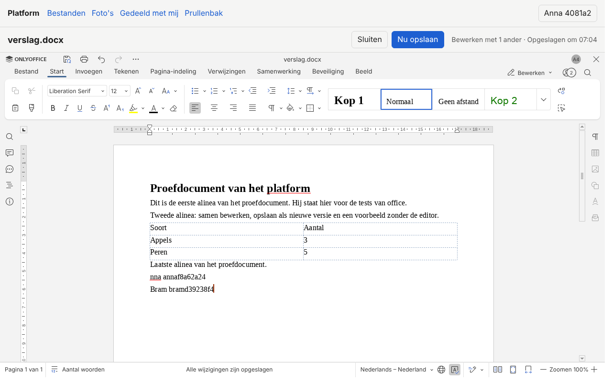

# Fase 4 — Klaar als: het bewijs

Bouwontwerp §4.5, §4.6 en §5 stap 4. Hier staat per punt van "Klaar als" welke test het bewijst,
met welke run, en wat de sandbox niet kan bewijzen. De echte editor is OnlyOffice Docs Community
10.0.0.1 (hierna DS), in een eigen container naast de app, zoals in de job `office` van CI.

## Kort

| Klaar als (stappenplan en [README](README.md)) | Uitslag |
|---|---|
| Twee gebruikers bewerken tegelijk één docx | **bewezen** met de echte DS en met de nep-DS |
| Opslaan maakt een nieuwe versie | **bewezen** met de echte DS en met de nep-DS, en in de installatietest |
| Office-preview werkt zonder de editor te openen | **bewezen** met de echte DS (vijf formaten) en met de nep-DS |

Op `f20b79d`: de e2e met de echte DS twee keer 22 van de 22 goed, niets overgeslagen; de e2e met
de nep-DS 30 van de 30. Wat alleen op Jonas' LXC kan, staat onderaan.

## De runs

| Run | Commit | Wat | Regel van pytest | Duur |
|---|---|---|---|---|
| 1 | `543b454` | `-m office_real`, nieuwe DS | `1 failed, 21 passed, 142 deselected in 315.34s (0:05:15)` | 5 min 16 s |
| 2 | `f20b79d` | `-m office_real`, dezelfde DS als run 1 | `22 passed, 142 deselected in 203.60s (0:03:23)` | 3 min 25 s |
| 3 | `f20b79d` | alleen `test_office_o3_real.py`, weer een nieuwe DS (koud) | `1 passed in 18.04s` | 19 s |
| 4 | `f20b79d` | `-m office_real`, dezelfde DS als run 3 | `22 passed, 142 deselected in 187.42s (0:03:07)` | 3 min 8 s |
| 5 | `f20b79d` | `-m office` (de nep-DS) | `30 passed, 134 deselected in 134.13s (0:02:14)` | 2 min 15 s |
| 6 | `f20b79d` | API: `uv run pytest -q -p no:cacheprovider` | `1631 passed, 1 skipped, 2 warnings in 690.22s (0:11:30)` | 11 min 40 s |

De duur is de tijd van het hele commando (`time`), dus met het starten van pytest. Run 1 faalde
in één test; de oorzaak zat in die test, niet in de app (zie "De val in run 1"). `543b454` en
`f20b79d` veranderen alleen e2e-tests: de app, de web-app, install.sh en de compose-bestanden
zijn gelijk aan die van de installatietest (`c036c50`, [integratie.md](integratie.md)).

De commando's, uit de hoofdmap van de repo:

```sh
export OFFICE_DS_NAME=bewijs-ds OFFICE_DS_PORT=18160 OFFICE_DS_DIR=<lege map> \
  OFFICE_DS_CONFIG=infra/single/office/local-production-linux.json
bash e2e/office_ds.sh start && bash e2e/office_ds.sh wait
(cd web && npm run build)
cd api
E2E_REAL_DS=http://127.0.0.1:18160 E2E_REAL_DS_SECRET_FILE=<lege map>/jwt.secret \
  E2E_ARTIFACTS=<map> uv run --with playwright pytest ../e2e -q -p no:cacheprovider \
  -m office_real -rs -s
E2E_ARTIFACTS=<map> uv run --with playwright pytest ../e2e -q -p no:cacheprovider -m office -rs
cd .. && bash e2e/office_ds.sh stop
```

`-s` laat de regels zien die de tests zelf schrijven (de tijden en het bewijs hieronder). Na de
runs is DS gestopt (`office_ds.sh stop`: de container en zijn volumes weg, de geheimen gewist).

### De omgeving

- De sandbox: 4 cpu's, 15 GB geheugen, Docker 29.9.1, Chromium 141 van Playwright. CI draait
  Chrome for Testing 156; dat kan hier niet.
- DS: het image op digest (`sha256:ca17889f…`, via mirror.gcr.io, met de naam van Docker Hub
  erop), gestart door `e2e/office_ds.sh` met de afscherming van Keuze 29 en de grenzen van 2 GB
  en 2 cores, en met `local-production-linux.json` van de installatie. `version` meldt
  10.0.0.169. Beide keren gezond en de font-herstart voorbij ±2 minuten na de start (de
  eerste keer gemeten: 120 s).
- Zoals in CI hangt DS hier aan de standaardbridge van Docker, niet aan het interne netwerk, en
  bereikt DS de app via `host.docker.internal`. Proxy, tunnel, cookie en tokens zijn gelijk aan
  productie (§4.5, "Verschil met productie"). Het interne netwerk bewijst de installatietest.

### De val in run 1

`test_office_o4_real.py::test_een_echte_editor_opent_ook_een_nieuw_engels_werkblad` stond na
`/bewerken/<id>` op de inlogpagina. De test opende `/map/<id>` en meteen daarna `/bewerken/<id>`,
terwijl de app op `/map` nog zijn sessie vernieuwde (`POST /api/v1/auth/refresh`). De server had
het refresh-token toen al gebruikt, maar de browser kreeg het nieuwe cookie nooit: de pagina was
al weg. De nieuwe pagina vroeg het met het oude cookie: drie keer `refresh_raced`, en na
`REFRESH_RACE` (5 s) telt dat als hergebruik en is de login weg. Het log van de server liet
precies dat zien: geen geslaagde refresh voor die browser, dan vier keer 401.

Nagespeeld met een kladtest (niet bewaard): een refresh die de server wel kreeg en de browser
niet, en dan een nieuwe pagina. Dezelfde vier keer 401, en de inlogpagina. Zo werkt de detectie
van een gestolen refresh-token bewust ([fase 3](../fase-3/README.md), "Bekende grenzen"). Een
gebruiker wacht ook tot de map er is. De fix (`f20b79d`) laat de test wachten op de knop New,
zoals de andere tests van O4. Gezocht in alle e2e naar een `goto` met meteen daarna nog een
`goto` of `reload`: dit was de enige plek.

## Twee gebruikers in één docx (§4.6 punt 1)

`e2e/test_office_o2_real.py::test_twee_gebruikers_een_docx`. De test schrijft zijn bewijs naar
`o2-echt-bewijs.json` in `E2E_ARTIFACTS`; die van run 4 staat in
[klaar/o2-echt-bewijs.json](klaar/o2-echt-bewijs.json). In deze stap kwamen er vier
controles bij (`543b454`): de gebeurtenissen van de editor zelf, de key in de config, de reden
waarmee de sessie dicht ging, en de versie byte voor byte.

| Wat §4.6 vraagt | Hoe de test het controleert | Run 4 | Run 1 en 2 |
|---|---|---|---|
| Anna (eigenaar) en Bram (deling met `write`), elk ingelogd met 2FA | `duo()` deelt de map Samen met Bram met schrijfrecht; 2FA aan voor allebei, dan inloggen met wachtwoord en TOTP-code in twee eigen browsercontexts | ja | ja |
| Beide openen via de knop Bewerken | de viewer van het bestand, Bewerken, `/bewerken/<id>`; `POST …/session` geeft 200 | ja | ja |
| Allebei `onDocumentReady` | de test luistert mee naar de berichten die de iframe van DS aan de pagina stuurt (alleen luisteren, de pagina merkt er niets van); `onDocumentReady` bij beide, geen `onError` | beide: `onAppReady`, `onRequestUsers`, `onInfo`, `onDocumentReady` | gelijk |
| Dezelfde key in beide configs | de key van de sessie is `config.document.key`, en die van Anna is die van Bram | `ace85f81…-73d66a54…` bij beide | gelijk bij beide |
| `info` op die key noemt beide gebruikers | de test stuurt `info` zelf naar DS, getekend met het geheim van de run; de gebruikers zijn precies de DS-id's van Anna en Bram | 2, precies Anna en Bram | gelijk |
| Tegelijk open | de statusregel zegt bij beide "Bewerken met 1 ander" | ja | ja |
| Anna en Bram typen terwijl beide open zijn | klik in het document in de iframe, dan het toetsenbord: `Anna anna<8 hex>` en `Bram bram<8 hex>` | `annaf8a62a24`, `bramd39238f4` | |
| Bram drukt Nu opslaan; de docx bevat **beide** woorden | het bestand via de API, binnen 60 s; de versielijst heeft er al één bij, terwijl beide nog open zijn | beide woorden na 1,1 s | 1,0 s, 1,0 s |
| Beide sluiten; binnen 30 s status 2 | `open` is leeg binnen 30 s, en de sessie is dicht met reden `saved`: dat doet alleen een callback bij het sluiten mét bestand, dus status 2 of status 3 met een url (status 4 geeft `no_changes`, status 3 zonder url `lost`). Welke van de twee het was, controleert de test niet; status 3 is een opslag die bij DS mislukte | 5,8 s, `saved` | 5,7 s, 5,7 s |
| Precies één versie meer, met de inhoud van vóór de sessie | 0 versies → 1; die versie is byte voor byte `proef.docx`, zonder een van beide woorden | ja | ja |
| `replaced_by` is Anna of Bram | de versie zegt wie hem verving | Bram | Bram, Bram |
| De huidige docx bevat beide woorden | na het sluiten opnieuw gelezen | ja | ja |
| Schermafdrukken van beide editors | `o2-echt-anna.png`, `o2-echt-bram.png` na Nu opslaan | hieronder | |

Twee kleine verschillen met de tekst van §4.6: de woorden zijn `Anna anna<hex>` in plaats van
`Anna-<willekeurig>`, en de test zoekt alleen het willekeurige deel. De echte editor slikt soms de
eerste toets na de klik in het document (o2.md, afwijking 32); op de schermafdruk van Bram staat
daarom "nna annaf8a62a24". "Nu opslaan" is status 6: de versie komt erbij terwijl beide editors
nog open zijn; de test controleert die status zelf niet apart.

Anna, na Nu opslaan (rechtsboven "2": twee mensen in het document):



Bram, op hetzelfde moment (de cursor van Anna staat achter haar woord):


## De andere punten met de echte DS (§4.5)

| Punt | Test | Uitslag (run 4; run 2 waar anders) |
|---|---|---|
| 0. Rooktest | `test_office_o0_real.py::test_rooktest` | `api.js` laadt via `/office/` onder de CSP van de app, `/healthcheck` is `true`, de app zegt `ok`, `version` zonder token geeft `error 6`, een docx wordt een PDF |
| 1. Twee gebruikers | zie hierboven | |
| 2. Voorbeeld zonder editor | `test_office_o3_real.py::test_voorbeeld_zonder_editor_echt` | proef.docx, .xlsx, .pptx, .doc en .rtf zijn `ready` binnen 60 s: koud (run 3, nieuwe DS) na 1,5 / 2,4 / 3,6 / 4,7 / 5,5 s vanaf het begin van de uploads. Elk geeft een PDF met pagina's en een thumbnail, en pagina's in de viewer. De browser stuurt niets naar `/office/`: geen verzoek, geen socket |
| 3. Nieuw docx, xlsx en pptx | `test_office_o4_real.py::test_nieuw_openen_sluiten_en_omzetten_echt[docx\|xlsx\|pptx]` en `::test_een_echte_editor_opent_ook_een_nieuw_engels_werkblad` | Nieuw met het toetsenbord, de echte editor opent zonder `onError` en zonder opnieuw te laden; sluiten zonder wijziging: de sessie dicht met `no_changes` (status 4), geen versie, de inhoud precies het lege bestand; de PDF met 1 pagina na 3,6 / 2,8 / 2,5 s (run 2: 3,3 / 2,8 / 22,3 s). "Downloaden als docx" geeft geen melding (A17). Het Engelse werkblad opent en sluit ook zonder versie |
| 4. Herstart van de app terwijl Anna bewerkt | `test_office_o2_real.py::test_herstart_van_de_app_terwijl_anna_bewerkt` | de server op PID gestopt en gestart: wat Anna typte, staat in het bestand, en opnieuw laden geeft 200 of 409 (dat controleert de test). In de uitvoer van run 2 en 4 stond daarna dezelfde key (de sessie liep door) en 1 versie; dat drukt de test alleen af, want A21 vindt ook een nieuwe key of een herstel goed, zolang er niets kwijt is |
| 5. Afscherming | `test_office_o1_real.py`: `test_afscherming_met_de_echte_ds`, `test_een_tweede_auth_over_een_andere_key_gaat_dicht`, `test_de_service_worker_van_de_editor_is_van_de_app`, `test_de_echte_editor_over_http_en_https` | de editorpagina als pagina is 404, zonder en met cookie; zonder cookie geen datapad (401 `office_gate`) en geen upgrade; een socket op key A met het token van key B gaat dicht na het eerste pakket; een tweede auth over een andere key op een goede socket gaat dicht voordat DS hem heeft; na het intrekken van de deling is Bram eruit, lukt een nieuwe socket met zijn oude sessietoken niet en noemt `info` hem niet meer; de service worker onder `/office/` is die van de app; de editor werkt over http en over https (Anna en Bram op dezelfde key) |
| Beheer (O5) | `test_office_o5_real.py::test_beheer_met_de_echte_ds` | het tabblad Office toont 2 verbindingen, 2 mensen en 1 document terwijl Anna en Bram bewerken, daarna 0; [schermafdruk](klaar/o5-echt-beheer.png) |
| Grenzen (O6) | `test_office_o6_real.py::test_grens_van_ds_gelijk_aan_die_van_de_app[docx\|pptx\|xlsx\|odt\|ods\|odp]` en `::test_gewoon_document_en_ai_uit` | net onder de grens zetten de app en DS om, net erboven weigeren beide; AI van DS staat uit |

Twee opmerkingen bij de tijden:

- In run 2 en 4 is punt 2 klaar na 0,2 tot 0,5 s. DS bewaart een conversie per key, en de key is
  de inhoud (`keys.convert_key`). Eerdere tests in dezelfde run zetten dezelfde proefbestanden al
  om, dus kwamen ze uit de cache van DS. Daarom run 3: alleen deze test, op een nieuwe DS. De
  metingen van de conversie staan in [metingen.md](metingen.md).
- De PDF van de nieuwe pptx in run 2 kwam na 22,3 s (de andere keren 2,5 tot 3,6 s). Een
  conversie wacht zolang er een sessie opent of opslaat, en er is één slot (Keuze 25,
  `convert.py` stap 5); de test staat 90 s toe. Waar die 22 s precies heen ging, is niet
  uitgezocht: het log van die run is er niet meer.

## De nep-DS bij elke PR (§4.6 punt 2)

Run 5, `-m office`: 30 goed. Onze kant is daarmee bewezen, ook als Docker Hub of de job `office`
een dag niet wil:

- samen bewerken en één versie: `test_office_o2.py::test_samen_bewerken_geeft_een_versie_met_beide_teksten`
  (dezelfde key, de nep-DS kent ze allebei, Nu opslaan geeft één versie, na Sluiten status 2 en
  nog steeds één versie, de versie is de inhoud van vóór de sessie),
  `test_office_o1.py::test_twee_contexts_bewerken_samen_via_de_tunnel` en
  `test_office_o0.py::test_twee_editors_via_proxy_en_tunnel`;
- de randgevallen terwijl er bewerkt wordt: hernoemen, prullenbak, deling ingetrokken, definitief
  verwijderd, DS weg en terug, de app weg en het herstel (`test_office_o2.py`);
- voorbeeld zonder editor: `test_office_o3.py::test_voorbeeld_zonder_editor` (geen socket,
  download of callback bij de nep-DS, niets naar `/office/`), plus de links en
  `test_zonder_office_geen_omzetting`;
- de toegang (`test_office_o1.py`), Nieuw (`test_office_o4.py`) en Beheer (`test_office_o5.py`),
  elk ook met alleen het toetsenbord.

## De installatie (§4.6 punt 3)

[integratie.md](integratie.md): `test_install_update.sh` op `c036c50`, 149 controles goed, 0
mislukt (twee runs). Een installatie uit fase 3 bijwerken, het interne netwerk (DS komt nergens,
de app bereikt DS), de geheimen uit `.env`, `office_misconfigured` bij een fout geheim, en
`docker compose stop` met een open editor: de getypte tekst komt als nieuwe versie in het
bestand. Sinds `c036c50` veranderden alleen documentatie en twee e2e-tests.

## Klaar als per pakket

Samengevat uit §3.8 en §2 van het [bouwontwerp](bouwontwerp.md) en uit o1.md tot en met o6.md.
De API-tests zijn van run 6; de e2e van run 4 en 5.

| Pakket | Klaar als | Bewezen met | Stand |
|---|---|---|---|
| O0 | migratie 0007 heen en terug; `db-downgrade`; elke vorm van token; `place_file` met `exact` en `squash`; de invoercontrole; de gezondheid (ook `misconfigured`); open verbindingen na een upgrade; alleen `engine.py` importeert de adapter; de nep-DS; de rooktest met de echte DS; de spike | `test_migration_0007.py`, `test_cli_db.py`, `test_office_tokens.py`, `test_place_file_exact.py`, `test_office_inspect.py`, `test_office_health.py`, `test_serve_upgrade.py`, `test_office_imports.py`, `test_fake_docserver.py`; `test_rooktest`; [spike.md](spike.md) | bewezen |
| O1 | elk pad uit de inventaris door, al het andere 404; zonder login of schrijfrecht van nu geen dynamisch pad, ook niet via de tunnel; de editorpagina als pagina 404; na het intrekken geen nieuwe verbinding (nep en echt); de editor via `/office/` op http en https met de echte DS | `test_office_paths.py`, `test_office_gate.py`, `test_office_proxy.py`, `test_office_tunnel.py`; e2e `test_office_o1.py` (7) en `test_office_o1_real.py` (4) | bewezen |
| O2 | twee gebruikers, één nieuwe versie met beide teksten (nep en echt); elke rij van Keuze 14, 15 en 19 een test; een forgotten file na een herstart van de app terug in de app; alleen met het toetsenbord openen, Nu opslaan en Sluiten | §4.6 punt 1 hierboven, `test_samen_bewerken_…`; `test_office_sessions.py`, `test_office_callback.py`, `test_office_policy.py`, `test_office_races.py` (de tabel in [o2.md](o2.md)); `test_office_recovery.py::test_bij_de_start_van_de_app_en_na_kick` en e2e `test_app_weg_tijdens_het_bewerken_het_herstel_zet_het_terug`; `test_toetsenbord_openen_opslaan_en_sluiten` en [toetsenbord-o2.md](toetsenbord-o2.md) | bewezen |
| O3 | voorbeeld zonder editor (nep en echt); niets naar DS zonder invoercontrole, en geen upload via een link vanzelf; zonder DS precies fase 3 | `test_voorbeeld_zonder_editor(_echt)`; `test_publieke_link_en_uploadlink`, `test_office_convert.py`; `test_office.py`, `test_viewer.py`, `test_viewer_office.py::test_zonder_office_precies_fase_3`, `test_office_pdf.py::test_zonder_office`, `test_zonder_office_geen_omzetting` ([o3.md](o3.md)) | bewezen |
| O4 | de drie soorten openen in de echte DS en worden een PDF; het menu met het toetsenbord | `test_nieuw_openen_sluiten_en_omzetten_echt[docx\|xlsx\|pptx]`; `test_nieuw_document_met_alleen_het_toetsenbord`, `test_nieuw_via_het_contextmenu_van_de_map` | bewezen |
| O5 | het tabblad toont de echte verbindingen (2 tijdens de test met twee gebruikers); terugzetten werkt; alle meldingen vertaald | `test_beheer_met_de_echte_ds`, `test_tabblad_office_toont_twee_verbindingen`; `test_niet_opgeslagen_terugzetten_na_ruimte`, `test_admin_office.py`; `office.test.ts` en `check:i18n --strict` ([o5.md](o5.md)) | bewezen; de web-checks zijn in deze stap niet opnieuw gedraaid (geen wijziging in `web/`) |
| O6 | bijwerken uit fase 3 geeft office aan, met de geheimen in `.env`, DS gezond, de app op zijn poort; `OFFICE=uit` en weer `aan`; een geblokkeerde pull; een pin; een losse `docker compose up -d`; `test_install_env.sh` en de job `infra` groen | de tabel "Klaar als" in [o6.md](o6.md) en [integratie.md](integratie.md) | bewezen in de sandbox; de LXC zelf niet |

## Wat de sandbox niet bewijst

- **Jonas' LXC.** De lijst met de reden per punt staat in [integratie.md](integratie.md), "Alleen
  op Jonas' LXC na te gaan": `docker info` (driver en grenzen), het image van Docker Hub op
  digest, het interne netwerk en geen poort voor DS, `ss -Hltn` op de LXC, de eerste start van
  DS met de pull, schijf en cpu van de LXC, en **één sessie met twee gebruikers via de echte
  installatie**. Twee gebruikers tegelijk zijn hier bewezen via het harnas (DS aan de
  standaardbridge, de app als proces); de installatietest typt met één gebruiker.
- **Andere browsers.** Alles hier is Chromium 141. CI draait Chrome for Testing 156, dat
  CSP-schendingen eerder meldt en meer cachet; de job `office` in CI is daar het bewijs. Safari,
  Firefox en mobiele apparaten zijn niet getest.
- **Een echt adres met een echt certificaat.** Https is getest met een zelfgetekend certificaat
  op 127.0.0.1 (`test_de_echte_editor_over_http_en_https`), niet via internet.
- **De schermafdrukken in CI.** §4.6 punt 1.7 zegt dat ze als artefact meegaan. De job `office`
  uploadt `E2E_ARTIFACTS` alleen bij een fout; bij een geslaagde run blijven ze op de runner. De
  schermafdrukken van deze run staan in [klaar/](klaar/).
- **Veel gebruikers en lange sessies.** Twintig bewerkers, stoppen en killen met open editors
  zijn gemeten in de sandbox ([metingen.md](metingen.md)), niet op de LXC.

## Checks

Op `f20b79d`, in de sandbox:

- e2e met de echte DS: run 2 en 4 hierboven (22 goed, 0 overgeslagen), run 3 (1 goed);
- e2e met de nep-DS: run 5 (30 goed);
- API (run 6): `uv sync --frozen`, `uv run ruff check .`, `uv run ruff format --check .`,
  `uv run ruff check ../e2e` en `uv run ruff format --check ../e2e` schoon; pytest 1631 goed.
  De ene overgeslagen test is `test_acme_pebble.py` (Pebble draait hier niet; CI heeft er een
  eigen job voor). De twee waarschuwingen (`InsecureKeyLengthWarning` van PyJWT) komen van
  `test_office_gate.py` en `test_office_stream.py`, die expres een token met een ander soort
  handtekening maken om de weigering te zien;
- web en infra: niet opnieuw gedraaid, want `web/` en `infra/` veranderden niet sinds de
  installatietest.
