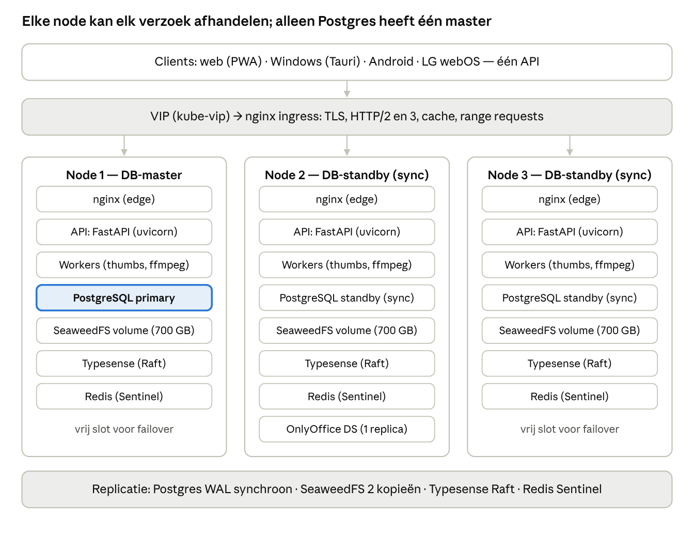
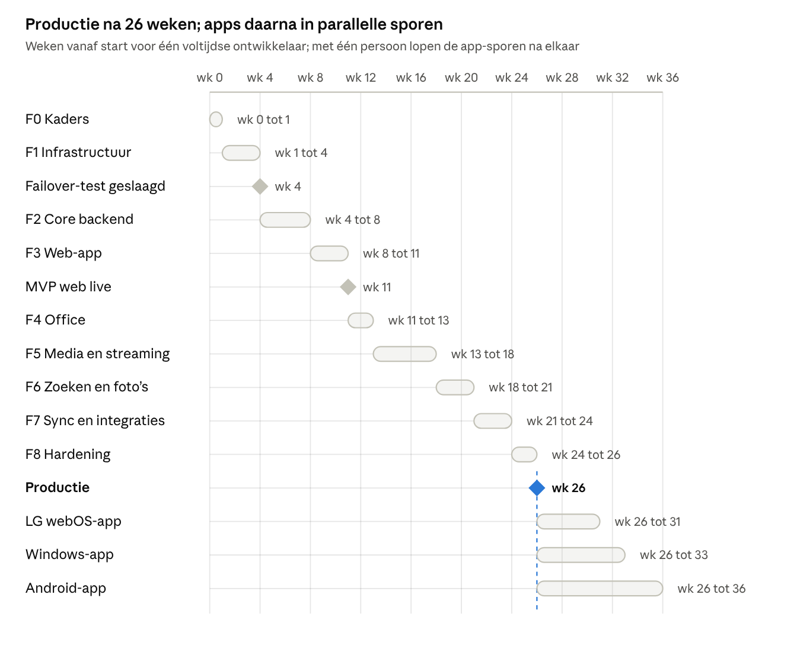

# Stappenplan: alles-in-één file/office/media-platform (3 nodes)

Oct 20, 2026 · @Jonas

## Samenvatting

Doel: één self-hosted platform voor bestanden, office-bewerking en
mediastreaming (de rol van Nextcloud, OnlyOffice en Plex samen), op 3
nodes, met een web-app eerst en apps voor Windows, Android en LG webOS
daarna.

De kern (API, opslag, bibliotheek, streaming) bouw je zelf in
Python/FastAPI achter nginx. Office-bewerking komt van een ingebouwde
OnlyOffice Document Server, video van ffmpeg. Alle clients praten tegen
dezelfde API, zodat de TV-app en de Windows-app grotendeels de webcode
hergebruiken.

Belangrijkste conclusies:

- Replicatie "om de paar uur" en "geen dataverlies bij failover" gaan
  niet samen: alles sinds de laatste sync is dan weg. Daarom: PostgreSQL
  met synchrone streaming-replicatie (1 master, 2 standbys) en bestanden
  in een object store die elke write synchroon op 2 nodes zet. De
  uursync blijft bestaan als snapshot- en backuplaag.

- 3 × 700 GB = 2,1 TB ruw ≈ 1,0 TB netto bij 2 synchrone kopieën
  (aanbevolen) of ≈ 0,7 TB bij 3 kopieën.

- [cluster-forge](https://github.com/silogen/cluster-forge) (silogen) is
  een Kubernetes-operator die platformtools op een bestaand cluster
  uitrolt; het plan gaat daarom uit van k3s op de 3 nodes, met Docker
  Compose als eenvoudiger terugvaloptie.

- Doorlooptijd: circa 26 weken tot productie (fase 0 t/m 8) voor één
  voltijdse ontwikkelaar; de drie apps daarna in sporen van 5 tot 10
  weken elk.

## Uitgangspunten en kernbeslissingen

Bouw de kern zelf, hergebruik wat je niet kunt winnen (office-engine,
transcoder, zoekmachine) en houd elke laag vervangbaar via
standaard-API's (S3, WebDAV, OpenAPI).

| Onderdeel                          | Beslissing                                                                                    | Waarom                                                                                                                                            |
|------------------------------------|-----------------------------------------------------------------------------------------------|---------------------------------------------------------------------------------------------------------------------------------------------------|
| Kern (API, bestanden, bibliotheek) | Zelf bouwen in FastAPI                                                                        | Eén datamodel voor bestanden én media; volledige controle over snelheid en features                                                               |
| Office-bewerking                   | OnlyOffice Document Server (community) inbouwen via de JS-API en een save-callback            | Een office-suite zelf bouwen is onhaalbaar; de community-versie is beperkt tot 20 gelijktijdige verbindingen, genoeg voor thuis of een klein team |
| Video en audio                     | Eigen bibliotheek + ffmpeg (HLS/CMAF); direct play waar de client het aankan                  | Plex-functionaliteit zonder Plex; transcoderen alleen als het moet                                                                                |
| Object storage                     | SeaweedFS (S3-API) met 2 synchrone kopieën; Garage als alternatief                            | MinIO community wordt sinds begin 2026 niet meer onderhouden; de S3-API houdt de laag uitwisselbaar                                               |
| Database                           | PostgreSQL 17: 1 primary + 2 standbys, synchrone replicatie                                   | Eén master zoals gewenst, zonder dataverlies bij failover                                                                                         |
| Orkestratie                        | k3s op 3 VM's (één per Proxmox-host) + cluster-forge; alternatief Docker Compose + keepalived | cluster-forge veronderstelt Kubernetes; Compose is simpeler maar automatiseert failover minder                                                    |
| Edge                               | nginx als ingress: TLS, HTTP/2 en HTTP/3, cache, range requests, X-Accel-Redirect             | Snelste pad voor statische assets, thumbnails en videosegmenten                                                                                   |
| Frontend                           | React + TypeScript + Vite als PWA                                                             | Zelfde code op LG webOS (web-app) en in Windows (Tauri)                                                                                           |
| Apps                               | Tauri (Windows), Kotlin/Compose + Media3 (Android), webOS-web-app (LG)                        | Beste native afspeel- en sync-ervaring per platform, één API                                                                                      |
| Zoeken                             | Typesense als 3-node cluster                                                                  | HA via Raft; Meilisearch draait alleen single-node                                                                                                |
| Hardware (aanname)                 | 3 bestaande Proxmox-hosts; per host 1 VM met aparte OS-disk en de 700 GB datadisk             | Geen dubbele replicatie: Proxmox repliceert de datadisk niet, de app-laag wel                                                                     |

Niet in scope voor nu: eigen office-engine, iOS-app, meerdere locaties.

## Architectuur

Elke node draait dezelfde stateless app-laag (nginx, API, workers) plus
een deel van de datalaag; alleen PostgreSQL heeft één master, de rest
werkt met replica's of quorum.

3-node architectuur · clients, edge, componenten per node, replicatie

Node 1 is alleen voor PostgreSQL de master; API, workers, opslag en
zoeken draaien op alle drie, en OnlyOffice draait als één replica die
bij uitval op een vrij slot van een andere node herstart.

### Dataflows

| Flow                | Pad                                                                                                                                                                                                           |
|---------------------|---------------------------------------------------------------------------------------------------------------------------------------------------------------------------------------------------------------|
| Upload              | client → nginx → API (TUS, chunks van 8–16 MB) → SeaweedFS (S3 put, 2 kopieën) → DB-record → jobs: thumbnail, tekstextractie, index                                                                           |
| Download en preview | client → nginx (cache voor thumbnails) → API autoriseert → X-Accel-Redirect of presigned URL naar SeaweedFS; range requests en ETag                                                                           |
| Streamen            | client vraagt afspeelinfo → API kiest direct play, remux of transcode op basis van het clientprofiel → ffmpeg-worker schrijft HLS-segmenten in de lokale cache → nginx serveert; de sessie blijft op één node |
| Office bewerken     | client laadt de editor van OnlyOffice DS → DS haalt het bestand op via de API (JWT) → bij opslaan callback naar de API → nieuwe versie in SeaweedFS                                                           |
| Events              | API publiceert op Redis pub/sub → WebSocket naar alle clients van die gebruiker (upload klaar, nieuwe deling, kijkvoortgang)                                                                                  |

## Storage, replicatie en failover

Zet replicatie synchroon in de datalaag (database en object store) en
gebruik de "om de paar uur"-sync alleen als snapshot- en backuplaag;
alleen zo is het dataverlies bij failover nul.

### Waarom niet alleen om de paar uur repliceren

- Bij failover verlies je alles sinds de laatste sync (RPO = uren): de
  uploads en bewerkingen van die middag zijn weg.

- Een oude master die terugkomt heeft nieuwere data dan de nieuwe
  master: conflicten of split-brain.

- Replicatie kopieert ook fouten en ransomware mee; het is geen backup.

### Opties voor de bestandslaag (3 × 700 GB)

| Optie                                                                               | Verlies bij failover | Schrijven bij 1 node down | Netto capaciteit            | Complexiteit    |
|-------------------------------------------------------------------------------------|----------------------|---------------------------|-----------------------------|-----------------|
| SeaweedFS, replicatie 001 (2 synchrone kopieën op verschillende nodes) — aanbevolen | 0                    | ja                        | ≈ 1,0 TB                    | laag tot middel |
| Garage, replicatiefactor 3 (quorum 2 van 3)                                         | 0                    | ja                        | ≈ 0,7 TB                    | laag            |
| SeaweedFS, replicatie 002 (3 kopieën)                                               | 0                    | nee, 3 servers nodig      | ≈ 0,7 TB                    | middel          |
| Ceph via Proxmox (pool size 3, min_size 2)                                          | 0                    | ja                        | ≈ 0,7 TB (size 2: ≈ 1,0 TB) | hoog            |
| 1 master + ZFS-send of rsync om de paar uur                                         | tot enkele uren      | alleen op de master       | ≈ 0,7 TB                    | laag            |

Aanbeveling: SeaweedFS met replicatie 001 voor alles, plus een
nachtelijke offsite-backup van de onvervangbare buckets (foto's,
documenten). Twee synchrone kopieën overleven één node-uitval zonder
verlies; de backup dekt een dubbele uitval en menselijke fouten. Bron
voor de MinIO-status: [It's FOSS, MinIO stapt af van open
source](https://itsfoss.com/news/minio-moves-away-from-open-source/).

### Database

- 1 primary + 2 standbys met synchronous_commit = on en
  synchronous_standby_names = 'ANY 1 (n2, n3)': een commit is pas klaar
  als minstens één standby hem op disk heeft (RPO 0; kost ongeveer 1 ms
  per commit op LAN).

- Automatische failover met quorum: CloudNativePG op k3s, of Patroni +
  etcd zonder Kubernetes. Promotie alleen bij meerderheid, dus geen
  split-brain; de oude primary keert terug als standby via pg_rewind.

- Apps verbinden via één service of VIP die de primary volgt, met
  PgBouncer ervoor; leesverkeer kan optioneel naar de standbys.

- pgBackRest: continue WAL-archivering naar de object store plus een
  dagelijkse basisbackup, zodat point-in-time restore mogelijk is.

### Disk-indeling per node (richtlijn, 700 GB)

| Deel             | Grootte  | Inhoud                                                   |
|------------------|----------|----------------------------------------------------------|
| SeaweedFS volume | ≈ 560 GB | bestanden, versies, thumbnails (2 kopieën cluster-breed) |
| PostgreSQL       | 30 GB    | metadata, gebruikers, bibliotheek, zoek-embeddings       |
| Typesense        | 20 GB    | zoekindex (Raft-replica)                                 |
| Transcode-cache  | 60 GB    | HLS-segmenten, lokaal, regenereerbaar                    |
| Logs en metrics  | 20 GB    | Loki en Prometheus, lokaal                               |

### Snapshots en backups (de "om de paar uur"-laag)

- ZFS op de datadisk: snapshot elk uur, bewaar 24 uur, 7 dagen en 4
  weken (sanoid); beschermt tegen verwijderen en ransomware.

- Nachtelijks restic of kopia naar een externe disk of offsite (Hetzner
  Storage Box, Backblaze B2), append-only: de 3-2-1-regel.

- Restore-oefening elk kwartaal: DB point-in-time en één bucket
  terugzetten.

### Failover-scenario: node 1 (master) valt uit

1.  De health-check faalt (10 tot 30 s); de synchrone standby wordt
    primary, 0 commits verloren.

2.  VIP en ingress sturen verkeer naar nodes 2 en 3; lopende uploads
    hervatten via hun TUS-offset; streamingsessies van node 1 starten
    binnen seconden opnieuw op een andere node.

3.  SeaweedFS blijft lezen en schrijven met 2 van de 3 volume servers;
    volumes met een kopie op node 1 zijn read-only tot node 1 terug is
    en volume.fix.replication ze aanvult.

4.  Node 1 keert terug als standby (DB) en als volume server
    (bestanden); niets wordt handmatig gepromoveerd.

## Techstack

Elke laag heeft één hoofdkeuze en één terugvaloptie; de koppelvlakken
(S3, SQL, OpenAPI, HLS) blijven standaard zodat je later kunt wisselen
zonder de rest aan te raken.

| Laag                     | Keuze                                                                                                                      | Terugvaloptie                 | Opmerking                                                                 |
|--------------------------|----------------------------------------------------------------------------------------------------------------------------|-------------------------------|---------------------------------------------------------------------------|
| Edge                     | nginx (ingress-nginx op k3s): TLS 1.3, HTTP/2 + HTTP/3, brotli, proxy_cache voor thumbnails, slice/range, X-Accel-Redirect | HAProxy                       | VIP via kube-vip (k3s) of keepalived (Compose)                            |
| Backend                  | Python 3.12, FastAPI, uvicorn + uvloop, Pydantic v2, SQLAlchemy 2 async + asyncpg, Alembic, orjson, httpx                  | Granian als server            | Alles async; geen blocking werk in de request-cyclus                      |
| Jobs                     | Celery met Redis-broker; queues: thumbs, index, transcode                                                                  | Dramatiq, arq                 | Transcode-queue alleen op nodes met GPU of vrije CPU                      |
| Database                 | PostgreSQL 17 + pgvector; CloudNativePG; PgBouncer                                                                         | Patroni + etcd                | Synchrone replicatie, zie storage-sectie                                  |
| Object storage           | SeaweedFS (master ×3, volume server per node, S3-gateway)                                                                  | Garage, Ceph RGW              | Buckets: vault, media, thumbs, cache                                      |
| Cache, pub/sub           | Redis 7 met Sentinel (3)                                                                                                   | Valkey                        | Sessies, rate limits, events, Celery-broker                               |
| Zoeken                   | Typesense 3-node cluster                                                                                                   | Meilisearch (single node)     | Full-text, facetten, typo-tolerantie                                      |
| Office                   | OnlyOffice Document Server (community)                                                                                     | Collabora Online (WOPI)       | DS gekoppeld aan eigen Postgres/Redis/RabbitMQ zodat hij verplaatsbaar is |
| Media                    | ffmpeg 7 + ffprobe, HLS/CMAF (fMP4), VAAPI/QSV/NVENC; guessit voor bestandsnamen; TMDB/TVDB/MusicBrainz                    | —                             | Direct play eerst, dan remux, dan transcode                               |
| Afbeeldingen en previews | libvips (pyvips), libheif, rawpy, exiftool; poppler voor PDF; OnlyOffice-conversie of LibreOffice headless voor office     | ImageMagick                   | Thumbnails 256/1024 px als WebP/AVIF                                      |
| Tekst en OCR             | Apache Tika of unstructured; ocrmypdf + tesseract (nld, eng)                                                               | —                             | Draait als job, nooit in de request                                       |
| Auth                     | Eigen in FastAPI: argon2id, JWT access (15 min) + roterende refresh, TOTP, passkeys (py_webauthn)                          | OIDC via Authentik            | Later ook OIDC-login voor apps                                            |
| Uploads                  | TUS-protocol (resumable, parallel chunks), SHA-256 voor dedupe, libmagic voor mime                                         | —                             | ClamAV-scan asynchroon                                                    |
| Realtime                 | WebSocket in FastAPI + Redis pub/sub                                                                                       | SSE                           | Per gebruiker een kanaal                                                  |
| Web                      | React 19, TypeScript, Vite, TanStack Query/Router, hls.js, PDF.js, virtualized grid, PWA (workbox)                         | Svelte                        | Zelfde componenten voor de TV-app                                         |
| Windows                  | Tauri 2 (Rust shell) + web-UI; sync-engine in Rust                                                                         | Electron                      | WebView2 speelt HLS via hls.js                                            |
| Android                  | Kotlin, Jetpack Compose, Media3/ExoPlayer, WorkManager                                                                     | React Native                  | Native afspelen, auto-upload, offline                                     |
| LG TV                    | webOS-web-app (HTML5, React of Enact)                                                                                      | —                             | Native \<video\> speelt HLS; afstandsbediening via spatial navigation     |
| Infra en CI              | Ansible (VM's, k3s), Helm/Kustomize, cluster-forge, Argo CD of Flux, GitHub Actions of Gitea Actions, eigen registry       | Docker Compose + shellscripts | GitOps: elke deploy is een commit                                         |
| Observability            | Prometheus, Grafana, Loki, Alertmanager; OpenTelemetry in FastAPI                                                          | —                             | Alerts: node down, replicatielag, disk \> 80 %                            |
| Backup                   | pgBackRest (PITR), restic of kopia offsite, ZFS-snapshots (sanoid)                                                         | —                             | Restore-test per kwartaal                                                 |
| Security                 | cert-manager (Let's Encrypt, DNS-01 wildcard), CrowdSec, Coraza/ModSecurity WAF, ClamAV, sops + age voor secrets           | WireGuard-only toegang        | Admin-UI op apart subdomein                                               |

## Kern-datamodel

Bestanden en media delen één boom: een media-item verwijst altijd naar
een bestand in de boom, en de inhoud zelf ligt content-addressed in de
object store zodat dubbele uploads geen ruimte kosten.

| Entiteit                | Kernvelden                                                                                                                                                                     | Opmerking                                                         |
|-------------------------|--------------------------------------------------------------------------------------------------------------------------------------------------------------------------------|-------------------------------------------------------------------|
| user                    | id, email, password_hash, totp_secret, role, quota_bytes, created_at                                                                                                           | groepen via user_group; gezinsprofielen onder één account         |
| session, refresh_token  | user_id, device, token_hash, expires_at, revoked_at                                                                                                                            | per apparaat intrekbaar                                           |
| node (boom)             | id, parent_id, owner_id, name, kind (file/dir), mime, size, blob_id, etag, created_at, modified_at, deleted_at                                                                 | prullenbak = deleted_at gezet; pad als materialized path of ltree |
| blob                    | sha256 (PK), size, bucket, key, ref_count                                                                                                                                      | content-addressed; dedupe; opschonen bij ref_count 0              |
| version                 | node_id, blob_id, created_by, created_at, comment                                                                                                                              | elke save van OnlyOffice of overschrijving wordt een versie       |
| share                   | node_id, grantee (user, group of link), permissions, expires_at, password_hash, upload_only                                                                                    | publieke links met token                                          |
| tag, node_tag, favorite | naam, kleur; node_id, user_id                                                                                                                                                  | handmatig én automatisch (AI)                                     |
| library                 | id, type (movies, series, music, photos), root_node_id, scan_interval, owner                                                                                                   | scanner werkt per bibliotheek                                     |
| media_item              | library_id, node_id, kind (movie, episode, track, photo), title, year, external_ids (tmdb, tvdb, musicbrainz), duration_ms, streams (jsonb: codecs, HDR, kanalen, ondertitels) | series: show en season als eigen rijen                            |
| playback_state          | user_id, media_item_id, position_ms, watched, updated_at                                                                                                                       | synchroniseert tussen apparaten                                   |
| photo_meta              | node_id, taken_at, lat, lon, camera, width, height, phash, embedding (vector)                                                                                                  | tijdlijn, kaart, duplicaten, semantisch zoeken                    |
| person, face            | naam; node_id, bbox, embedding, person_id                                                                                                                                      | gezichtsherkenning (lokaal)                                       |
| job                     | type, status, payload (jsonb), attempts, started_at, finished_at, error                                                                                                        | zichtbaar in de admin-UI                                          |
| device, push_token      | user_id, platform, name, capabilities (jsonb), token                                                                                                                           | clientprofiel bepaalt direct play of transcode                    |
| audit_log               | actor_id, action, target, ip, created_at                                                                                                                                       | onveranderlijk, apart bewaard                                     |

## Stappenplan per fase

Negen fasen met harde "klaar als"-criteria; elke fase is één epic in je
projecttool en elke taak hieronder één ticket. Duur is een richtlijn
voor één voltijdse ontwikkelaar.

### Fase 0 — Kaders (1 week)

Doel: alle beslissingen vast voordat er infrastructuur staat.

- [ ] Projectnaam, domein, monorepo-structuur: /api, /web, /infra,
  /apps/windows, /apps/android, /apps/webos

- [ ] Beslissen: k3s + cluster-forge of Docker Compose; SeaweedFS 001 of
  Garage; OnlyOffice of Collabora

- [ ] Hardware-inventaris per node: CPU, RAM, disk, NIC, GPU of iGPU
  voor transcoding (QSV/VAAPI)

- [ ] Capaciteitsplan: verdeling van de 700 GB, groeipad (extra disks of
  nodes)

- [ ] Netwerk: eigen VLAN voor het cluster, VIP-adres, interne en
  externe DNS, toegang van buiten (WireGuard of reverse proxy)

- [ ] Niet-functionele eisen vastleggen: aantal gelijktijdige streams,
  max. uploadgrootte, RPO 0, RTO \< 2 min, backupretentie

- [ ] Repo met CI-skelet (lint, tests, image-build)

Klaar als: beslissingen en architectuurschets zijn vastgelegd in dit
document en het repo bouwt een lege API- en web-image.

### Fase 1 — Infrastructuur (3 weken)

Doel: 3 nodes die een node-uitval overleven zonder dataverlies, nog
zonder applicatie.

- [ ] 3 VM's (1 per Proxmox-host) via Ansible: OS-disk, 700 GB datadisk
  met ZFS, vast IP, hardening (sshd, firewall, unattended upgrades)

- [ ] k3s-cluster met 3 control-plane nodes (embedded etcd) en kube-vip
  voor de VIP; alternatief Compose + keepalived

- [ ] cluster-forge uitrollen; vastleggen welke componenten het levert
  (Postgres-operator, storage, ingress, cert-manager, monitoring) en wat
  je zelf toevoegt

- [ ] PostgreSQL-cluster: 1 primary + 2 standbys, synchrone replicatie
  (ANY 1), PgBouncer, pgBackRest met WAL-archivering

- [ ] SeaweedFS: 3 masters (Raft), volume server per node, filer +
  S3-gateway, replicatie 001, buckets vault/media/thumbs/cache

- [ ] Redis Sentinel (3) en Typesense-cluster (3)

- [ ] nginx ingress + TLS via cert-manager (Let's Encrypt, DNS-01
  wildcard)

- [ ] Monitoring: Prometheus, Grafana, Loki, Alertmanager; alerts op
  node down, replicatielag, disk \> 80 %, backup mislukt

- [ ] Backups: ZFS-snapshots per uur (sanoid), nachtelijke restic-backup
  naar externe disk of offsite, pgBackRest-basisbackup

- [ ] GitOps: Argo CD of Flux; deploy = merge naar main

- [ ] Failover-test: node 1 hard uit; meet promotietijd, VIP-overname,
  S3-writes; herstel en re-sync documenteren als runbook

Klaar als: node uitschakelen geeft 0 verloren commits en 0 verloren
objecten, service terug binnen 2 min; restore-test van DB
(point-in-time) en één bucket geslaagd.

### Fase 2 — Core backend (4 weken)

Doel: een volledige bestanden-API waar web en apps op kunnen bouwen.

- [ ] FastAPI-skelet: settings, logging, OpenTelemetry,
  health/ready-endpoints, Alembic-migraties, pytest + testcontainers

- [ ] Auth: registratie en login (argon2id), JWT + roterende refresh,
  TOTP, rate limiting, sessies per apparaat, rollen (admin, user, guest)

- [ ] Bestandsboom-API: mappen, hernoemen, verplaatsen, kopiëren,
  prullenbak, versies, quota, ETag

- [ ] Upload via TUS: resumable, parallelle chunks, SHA-256 en dedupe,
  mime-detectie (libmagic), ClamAV-scan als job

- [ ] Download en preview: X-Accel-Redirect of presigned URL, range
  requests, 304 op ETag

- [ ] Workers: thumbnails en previews voor alle types uit de tabel
  hieronder; retries en dead-letter-queue

- [ ] Zoeken v1: Typesense-index op naam, pad, type, tags

- [ ] Delen v1: met gebruiker of groep, publieke link met wachtwoord en
  vervaldatum, upload-only link

- [ ] WebSocket-events: upload klaar, preview klaar, nieuwe deling

- [ ] Load-test met k6: 50 parallelle uploads, 200 req/s op listing

Klaar als: een upload van 1 GB hervat na een netwerkbreuk; dedupe werkt;
elk type uit de tabel krijgt een preview; de OpenAPI-spec genereert een
werkende TypeScript- en Kotlin-client.

### Fase 3 — Web-app (3 weken)

Doel: dagelijks bruikbare web-app voor bestanden en foto's.

- [ ] React + Vite + TypeScript, design-system (tokens, dark mode),
  routing, auth-flows incl. 2FA

- [ ] Bestandsbrowser: lijst en grid (virtualized), drag-and-drop,
  bulkacties, contextmenu, sneltoetsen

- [ ] Upload-UI: TUS, voortgang, pauze en hervat, mapupload

- [ ] Viewers: afbeeldingen (zoom, EXIF), PDF (PDF.js), video (hls.js),
  audio, tekst en code, office-preview

- [ ] Foto-tijdlijn op datum, albums, selectie en delen

- [ ] Delen-UI, prullenbak, versiegeschiedenis

- [ ] PWA: installeerbaar, offline-shell; i18n NL en EN

- [ ] Admin: gebruikers, quota, jobs, systeemstatus, opslaggebruik per
  node

Klaar als: Lighthouse performance \> 90; eerste weergave \< 1,5 s op
LAN; alle acties ook via toetsenbord; 10.000 bestanden in één map
scrollen soepel.

### Fase 4 — Office (2 weken)

Doel: documenten bekijken, maken en samen bewerken.

- [ ] OnlyOffice Document Server uitrollen met JWT-secret en eigen
  Postgres, Redis en RabbitMQ zodat hij op elke node kan starten

- [ ] Editor-integratie: config vanuit de API, document-key per versie,
  callback-endpoint (save en forcesave), co-editing

- [ ] Nieuw document (docx, xlsx, pptx) vanuit sjablonen

- [ ] Conversie-API gebruiken voor previews en PDF-export van
  office-bestanden

- [ ] Limiet community-editie (20 verbindingen) meten en bewaken;
  Collabora als terugvaloptie klaarzetten

Klaar als: twee gebruikers bewerken tegelijk één docx; opslaan maakt een
nieuwe versie; office-preview werkt zonder editor te openen.

### Fase 5 — Media en streaming (5 weken)

Doel: films, series en muziek afspelen op elk apparaat, met zo weinig
mogelijk transcoding.

- [ ] Bibliotheken (films, series, muziek, foto's) met scanner
  (inotify + periodiek) en bestandsnaam-parsing (guessit)

- [ ] Metadata: TMDB, TVDB, MusicBrainz; posters en fanart; handmatig
  koppelen en corrigeren

- [ ] ffprobe-analyse: codecs, streams, HDR, audiokanalen, ondertitels

- [ ] Afspeelbeslissing per clientprofiel: direct play, remux of
  transcode

- [ ] Transcoder-worker: ffmpeg naar HLS/CMAF, ladder 1080p/720p/480p,
  hardware-acceleratie, tone-mapping HDR naar SDR

- [ ] Sessiebeheer: sessie gepind op één node, segmenten in lokale
  cache, opruimen na afloop, hervatten op andere node bij uitval

- [ ] Ondertitels: extractie naar WebVTT, externe .srt, keuze in de
  player

- [ ] Scrub-thumbnails (sprites) en hoofdstukken

- [ ] Kijkvoortgang per gebruiker en profiel: verder kijken, volgende
  aflevering, gezien markeren

- [ ] Muziek: albums, artiesten, afspeellijsten, gapless afspelen

- [ ] Web-player: hls.js, kwaliteitskeuze, audiotrack,
  picture-in-picture, toetsenbord

- [ ] Load-test: aantal gelijktijdige transcodes per node vastleggen

Klaar als: een 1080p-film start binnen 2 s (direct play) en 5 s
(transcode); seek werkt; 3 gelijktijdige transcodes zonder haperen;
voortgang synchroniseert tussen apparaten.

### Fase 6 — Zoeken en foto's (3 weken)

Doel: alles terugvinden, ook op inhoud en op wat er op een foto staat.

- [ ] Full-text: tekstextractie voor pdf, docx, xlsx, pptx, txt, md; OCR
  voor scans en foto's met tekst

- [ ] EXIF en GPS: datum, camera, locatie; kaartweergave; offline
  reverse geocoding

- [ ] Duplicaten en near-duplicates (SHA-256 + perceptual hash)

- [ ] Gezichten en objecten met lokale modellen (bijv. InsightFace +
  CLIP); semantisch zoeken via pgvector

- [ ] Herinneringen (vandaag X jaar geleden) en slimme albums

- [ ] Filters: type, datum, persoon, locatie, tag, bibliotheek

Klaar als: een zoekopdracht over 100.000 bestanden antwoordt binnen 200
ms; OCR-tekst is doorzoekbaar; gezichten zijn te benoemen en te zoeken.

### Fase 7 — Sync, delen en integraties (3 weken)

Doel: bestanden overal in sync en bereikbaar voor andere software.

- [ ] WebDAV-endpoint, compatibel met rclone en bestaande sync-clients

- [ ] Delta-sync-API voor eigen apps (change-feed met cursor),
  conflictafhandeling

- [ ] Auto-upload-API voor mobiel (camerarol), dedupe op client-hash

- [ ] Externe opslag koppelen (SMB, NFS, S3) als alleen-lezen
  bibliotheken

- [ ] Notificaties: web-push en e-mail; activiteitenfeed

- [ ] Optioneel: Chromecast, DLNA, Kodi-plugin

Klaar als: rclone sync werkt; een wijziging op apparaat A is binnen 5 s
zichtbaar op apparaat B.

### Fase 8 — Hardening en productie (2 weken)

Doel: veilig open naar buiten en aantoonbaar herstelbaar.

- [ ] Security-review: CSP, HSTS, CSRF, rate limits,
  brute-force-lockout, dependency-scanning in CI

- [ ] WAF (Coraza/ModSecurity) + CrowdSec; toegang van buiten alleen via
  WireGuard of reverse proxy met 2FA

- [ ] Audit-log, data-export en account verwijderen

- [ ] Runbooks: failover, node vervangen, disk vol, certificaat
  verlopen, restore

- [ ] Chaos-test: node uit, disk vol, netwerkpartitie, Redis weg

- [ ] Documentatie voor beheerder en gebruiker

Klaar als: RPO 0 en RTO \< 2 min zijn aangetoond met een opgenomen test;
de security-checklist is afgevinkt; volledige restore uit backup
geoefend.

### Fase 9 — Apps

Zie de sectie Apps: drie sporen die na fase 5 kunnen starten zodra de
media-API stabiel is.

### Fase 10 — Omzetten en bewerken (2 weken)

Doel: wat [Tangerine](https://tangerineformac.com/) op de Mac doet, maar dan in de web-app
en dus op elk apparaat: een bestand met een paar klikken omzetten naar een ander formaat of
snel bewerken, zonder dat het het platform verlaat. Geen Mac-app installeren; het werk
draait als job in de eigen container, net als de previews.

Volgorde: staat los van de productie-poort na fase 8 en kan starten na fase 5 (ffmpeg en
hardware-acceleratie) en fase 4 (office-conversie). Afbeeldingen, audio en archieven kunnen
al eerder, want die hebben alleen de job-queue uit fase 2 nodig.

- [ ] Omzet-engine als job (de eigen job-queue uit fase 2): per brontype de mogelijke
  doelen; het resultaat komt als nieuw bestand naast het origineel, of als nieuwe versie
  als je "vervangen" kiest; voortgang en klaar-melding via de live events

- [ ] Afbeeldingen: jpg, png, webp, avif, heic, gif, bmp, tiff en ico onderling, en naar pdf

- [ ] Audio: mp3, aac/m4a, flac, ogg/opus en wav onderling, met keuze voor kwaliteit

- [ ] Video: mp4 (H.264, HEVC), webm, mkv, mov en gif; alleen het geluid eruit halen

- [ ] Documenten: docx, odt, rtf, txt, md en html naar pdf en onderling; xlsx, ods en csv
  onderling; pptx en odp naar pdf (via de office-conversie uit fase 4)

- [ ] Archieven: inpakken als zip, tar.gz of 7z (meerdere bestanden of een map) en
  uitpakken naar een map

- [ ] Bewerktools: verkleinen, comprimeren (op kwaliteit of doelgrootte), draaien,
  spiegelen, bijsnijden, metadata en GPS-locatie weghalen; pdf's samenvoegen, splitsen,
  pagina's draaien en comprimeren; video en audio inkorten en het volume gelijk trekken

- [ ] Bediening, gewoon in de bestandsverkenner van de cloud (geen aparte pagina):
  "Omzetten naar…" en "Bewerken" in het actiemenu, op één bestand of een hele selectie;
  dezelfde acties via de API voor de apps

- [ ] Het schuifeffect van Tangerine: begin je een bestand (of selectie) te slepen, dan
  schuift er een omzet-lade in vanaf de rand met de doelformaten die bij dat type passen,
  gegroepeerd (bijv. "Afbeelding", "Document", "Kleiner maken"). Het doel onder je cursor
  licht op en schuift wat open; loslaten start de omzetting en het bestand "vliegt" de lade
  in, waarna de voortgang op die plek verschijnt. Zelf gebouwd met CSS-transities, geen
  animatiebibliotheek; met `prefers-reduced-motion` zonder beweging. Op een telefoon of
  tablet opent lang drukken dezelfde lade, en met het toetsenbord gaat het ook

- [ ] Voorinstellingen voor wat vaak voorkomt, met één klik (bijv. "HEIC naar JPG",
  "video kleiner voor WhatsApp", "foto's zonder locatie")

Klaar als: elke omzetting uit de lijst heeft een test; 100 foto's omzetten loopt als één
batch met voortgang; het origineel blijft ongewijzigd tenzij je "vervangen" kiest, en dan
is het als versie terug te zetten; slepen naar de lade werkt vloeiend in Chrome, Firefox
en Safari, en lang drukken op een telefoon.

### Preview-pipeline per bestandstype

| Type          | Extensies                                                                           | Thumbnail en preview                                | Bekijken of bewerken                         |
|---------------|-------------------------------------------------------------------------------------|-----------------------------------------------------|----------------------------------------------|
| Afbeeldingen  | jpg, jpeg, png, gif, webp, avif, heic, bmp, tiff, ico, svg; RAW: cr2, nef, arw, dng | libvips (+ libheif, rawpy) naar WebP 256 en 1024 px | viewer met zoom, EXIF, draaien en bijsnijden |
| PDF           | pdf                                                                                 | poppler (pdftoppm) eerste pagina                    | PDF.js, later annotaties                     |
| Office        | docx, xlsx, pptx, odt, ods, odp, doc, xls, ppt, rtf, csv                            | OnlyOffice-conversie naar PDF en PNG                | OnlyOffice-editor                            |
| Tekst en code | txt, md, json, yaml, xml, html, py, js, ts, sh en meer                              | eerste regels als tekst                             | CodeMirror met highlighting, Markdown-render |
| Video         | mp4, mkv, avi, mov, webm, m4v, ts, wmv, flv                                         | ffmpeg-frame + sprite-sheet                         | HLS of direct play, ondertitels              |
| Audio         | mp3, flac, aac, m4a, ogg, opus, wav                                                 | ingesloten cover art                                | player, afspeellijsten                       |
| Archieven     | zip, rar, 7z, tar, gz                                                               | inhoudslijst                                        | uitpakken naar map                           |
| E-books       | epub, mobi                                                                          | cover                                               | reader (later)                               |
| Overig        | alle andere                                                                         | mime-icoon                                          | download                                     |

## Apps: Windows, Android en LG webOS

Alle apps gebruiken dezelfde REST- en WebSocket-API en zo veel mogelijk
dezelfde webcode: LG webOS is een web-app, Windows een web-shell met
native sync, alleen Android is volledig native omdat afspelen en
achtergrondsync daar het meeste winnen.

| Platform | Stack                                                  | Deelt met web               | Platform-specifiek                                                                                                         | Richtduur      |
|----------|--------------------------------------------------------|-----------------------------|----------------------------------------------------------------------------------------------------------------------------|----------------|
| Windows  | Tauri 2 (Rust shell) + React-web-UI                    | hele UI en player           | sync-engine (watch folder, delta-sync, conflicten, selectieve sync), tray-icoon, autostart, notificaties, installer (MSI)  | 6 tot 8 weken  |
| Android  | Kotlin, Jetpack Compose, Media3/ExoPlayer, WorkManager | OpenAPI-gegenereerde client | auto-upload camerarol, offline downloads, achtergrondsync, Chromecast, biometrie, Android TV-variant later                 | 8 tot 10 weken |
| LG TV    | webOS-web-app (HTML5; React of Enact)                  | player en componenten       | 10-foot UI, afstandsbediening (spatial navigation), native \<video\> met HLS, profielen, verder kijken, screensaver-gedrag | 4 tot 6 weken  |

Wat de API al in fase 2 en 5 moet hebben voor de apps:

- Apparaatregistratie met clientprofiel (codecs, containers, max.
  bitrate, HDR) en push-token

- Token-refresh per apparaat en op afstand uitloggen

- Delta-sync-cursor en conflictregels (laatste schrijver wint +
  conflictkopie)

- Download-tokens voor offline gebruik met vervaldatum

- Afspeelinfo-endpoint dat direct play, remux of transcode teruggeeft
  met de HLS-URL

Volgorde: eerst LG TV (kleinste, hergebruikt de web-player en bewijst de
media-API), dan Windows (sync), dan Android.

## Extra features (backlog)

De Must-rijen zitten al in de fasen; Should en Could zijn de echte
extra's, gesorteerd op waarde voor een thuis- of gezinsplatform. Pas de
dropdowns aan als je anders prioriteert.

| Feature                                                          | Wat het oplevert                                              | Inspanning | Prioriteit |
|------------------------------------------------------------------|---------------------------------------------------------------|------------|------------|
| Resumable uploads met dedupe                                     | grote uploads hervatten; dubbele bestanden kosten geen ruimte | middel     | Must       |
| Versies en prullenbak                                            | fouten en ransomware terugdraaien                             | klein      | Must       |
| 2FA met TOTP                                                     | accountbeveiliging bij toegang van buiten                     | klein      | Must       |
| HLS met hardware-transcoding                                     | afspelen op elk apparaat, ook oude TV's                       | groot      | Must       |
| Kijkvoortgang en verder kijken op elk apparaat                   | het Plex-gevoel                                               | klein      | Must       |
| Full-text zoeken en OCR                                          | documenten en scans terugvinden op inhoud                     | middel     | Must       |
| Passkeys (WebAuthn)                                              | wachtwoordloos inloggen                                       | klein      | Should     |
| Gezichts- en objectherkenning, semantisch zoeken                 | zoeken op persoon en op wat er te zien is                     | groot      | Should     |
| Auto-upload camerarol (Android)                                  | foto's automatisch veilig                                     | middel     | Should     |
| Kaartweergave en reverse geocoding                               | foto's op locatie bekijken                                    | middel     | Should     |
| Duplicaten en near-duplicates                                    | ruimte winnen, makkelijk opruimen                             | klein      | Should     |
| Chromecast en DLNA                                               | afspelen op TV's zonder app                                   | middel     | Should     |
| Ondertitels downloaden (OpenSubtitles)                           | altijd passende ondertitels                                   | klein      | Should     |
| Gezinsprofielen en kinderslot                                    | per persoon een eigen bibliotheek en voortgang                | middel     | Should     |
| Externe opslag koppelen (SMB, NFS, S3)                           | bestaande NAS-mappen meenemen                                 | middel     | Should     |
| Upload-only droplink                                             | anderen laten aanleveren zonder account                       | klein      | Should     |
| Activiteitenfeed en notificaties                                 | zien wat er gebeurt, ook op mobiel                            | middel     | Should     |
| Intro overslaan en volgende aflevering                           | series kijken zonder frictie                                  | middel     | Could      |
| E2EE-mappen (client-side encryptie)                              | de server kan de inhoud niet lezen                            | groot      | Could      |
| PDF-annotaties en ondertekenen                                   | documenten afhandelen zonder andere tool                      | middel     | Could      |
| Documenten samenvatten en bevragen (lokale LLM, RAG op pgvector) | kennis uit je eigen archief halen                             | groot      | Could      |
| Automatische tags en albums                                      | minder handwerk bij foto's                                    | middel     | Could      |
| Pre-transcoding van populaire titels 's nachts                   | sneller starten, minder piekbelasting                         | klein      | Could      |
| Audiobooks en podcasts                                           | één app voor alle media                                       | middel     | Could      |
| Foto-bewerking (bijsnijden, filters, RAW)                        | geen aparte editor nodig                                      | middel     | Could      |
| Kodi-plugin                                                      | bestaande mediacenters aansluiten                             | klein      | Could      |
| Federatie tussen instanties                                      | delen met een andere server                                   | groot      | Later      |
| iOS, Android TV en Apple TV                                      | meer schermen                                                 | groot      | Later      |

## Risico's en mitigaties

De twee grootste risico's zijn dataverlies door asynchrone replicatie en
scope creep; allebei zijn ze in het plan afgedekt met synchrone
datalagen en harde fasecriteria.

| Risico                                                         | Kans                  | Impact | Mitigatie                                                                                                              |
|----------------------------------------------------------------|-----------------------|--------|------------------------------------------------------------------------------------------------------------------------|
| Replicatie om de paar uur geeft dataverlies bij failover       | hoog zonder maatregel | hoog   | synchrone DB-replicatie en 2 synchrone objectkopieën; de uursync alleen als snapshotlaag                               |
| Split-brain na een netwerkpartitie (twee masters)              | middel                | hoog   | quorum via etcd of Kubernetes; nooit handmatig een tweede primary; fencing in de failover-runbook                      |
| 1,0 TB netto is te klein voor een mediabibliotheek             | hoog                  | middel | replicatie 001 voor media, groeipad met extra disks; herdownloadbare content krijgt geen derde kopie of offsite-backup |
| OnlyOffice community-limiet van 20 verbindingen                | laag thuis            | middel | limiet bewaken; Collabora als klaarstaand alternatief                                                                  |
| Transcoding te zwaar voor CPU's van 5 jaar oud                 | middel                | middel | direct play maximaliseren; goedkope Intel Arc-kaart voor QSV (ook AV1); pre-transcoding 's nachts                      |
| Afhankelijkheid die stopt (zoals MinIO community)              | middel                | middel | standaard-API's als abstractie: SeaweedFS, Garage en Ceph zijn uitwisselbaar achter S3                                 |
| Scope creep: Nextcloud + Plex + OnlyOffice is groot            | hoog                  | hoog   | fasen met "klaar als"-criteria; web-MVP in fase 3 vóór media; backlog met dropdowns, niet in de fasen                  |
| Ransomware of een fout wist alles, replicatie kopieert het mee | middel                | hoog   | ZFS-snapshots per uur, offsite append-only backup, prullenbak en versies                                               |
| 1 GbE tussen de nodes wordt de bottleneck                      | middel                | laag   | 2,5 of 10 GbE tussen de nodes, of een aparte replicatie-VLAN                                                           |
| k3s en cluster-forge leercurve vertraagt fase 1                | middel                | middel | Compose als terugvaloptie met dezelfde containers; cluster-forge eerst in een test-VM proberen                         |
| Toegang van buiten lekt data                                   | laag                  | hoog   | WireGuard-only als standaard; publiek alleen achter WAF, 2FA en rate limiting                                          |

## Open beslissingen

Deze punten bepalen fase 0; zonder antwoord start fase 1 niet.

- [ ] Kubernetes (k3s + cluster-forge) of Docker Compose per node?

- [ ] SeaweedFS met replicatie 001 (≈ 1,0 TB netto) of Garage met factor
  3 (≈ 0,7 TB)? Of Ceph via Proxmox?

- [ ] OnlyOffice of Collabora?

- [ ] Toegang van buiten: alleen via WireGuard, of publiek via reverse
  proxy met WAF en 2FA?

- [ ] Welke node krijgt een GPU voor transcoding, en welke kaart (Intel
  Arc voor QSV)?

- [ ] Offsite-backupdoel: externe disk, Hetzner Storage Box of Backblaze
  B2?

- [ ] Eén ontwikkelaar of meerdere? Dit bepaalt of de app-sporen
  parallel lopen.

- [ ] Frontend definitief React, zodat LG webOS en Windows de webcode
  hergebruiken?

- [ ] Doet cluster-forge alleen de platformtools, of ook de app-deploys
  (Argo CD of Flux)?

## Mijlpalen en planning

planning in weken · 9 fasen, 3 mijlpalen, 3 app-sporen

Drie mijlpalen gelden als poort: de failover-test na fase 1, de web-MVP
na fase 3 en productie na fase 8; de app-sporen kunnen al na fase 5
starten als er een tweede ontwikkelaar is.

Fase 10 (omzetten en bewerken) kwam er later bij, op verzoek van Jonas. Ze staat los van
de mijlpalen en kan na fase 5 starten, net als de app-sporen.
